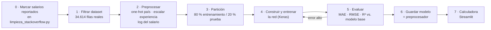
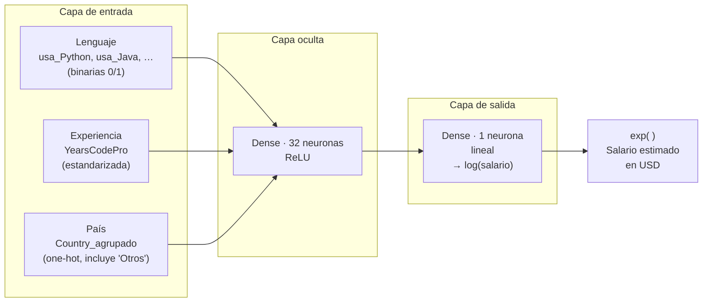

# Propuesta de proyecto: calculadora de salarios para programadores

Red neuronal de regresión sobre la encuesta Stack Overflow 2020, entrenada con el
dataset que produce `limpieza_stackoverflow.py`.

---

## 1. Idea general

La propuesta es entrenar una red neuronal que prediga el salario anual de un
programador a partir de tres datos: el lenguaje de programación que usa, sus años de
experiencia profesional y el país donde vive. El resultado final es una calculadora
sencilla: el usuario elige esos tres datos y la red devuelve un salario estimado en
dólares.

A diferencia de los trabajos anteriores con este dataset (PCA, K-Means, DBSCAN), que
buscaban descubrir estructura sin una respuesta conocida de antemano, este es un
problema de **aprendizaje supervisado**: la red aprende a partir de miles de salarios
reales reportados en la encuesta.

## 2. Tipo de problema

Es un problema de **regresión supervisada**:

- **Entrada:** tres variables (lenguaje, experiencia, país).
- **Salida:** un número continuo, el salario anual en USD.

Se propone una red neuronal *feedforward* sencilla, con una o dos capas ocultas. Con
solo tres variables de entrada y un dataset de este tamaño no hace falta una
arquitectura más compleja.

## 3. Variables de entrada y variable objetivo

| Variable | De dónde sale |
|---|---|
| Lenguaje de programación | Columnas binarias `usa_<lenguaje>` (`usa_Python`, `usa_JavaScript`, …), que la limpieza ya genera a partir de `LanguageWorkedWith`. La calculadora usa un lenguaje principal por consulta, no una combinación. |
| Años de experiencia profesional | Columna `YearsCodePro` del dataset limpio (años programando como parte de un trabajo, sin contar la formación). |
| País | Columna `Country_agrupado`, que agrupa en la categoría `"Otros"` los países con menos del 1 % de las respuestas. Así la red maneja menos categorías. |
| **Objetivo: salario** | Columna `ConvertedComp` (salario anual convertido a USD), **excluyendo** las filas con valor imputado (ver sección 4). |

## 4. Advertencia sobre los datos: el salario imputado

> **Punto crítico a resolver antes de entrenar**
>
> De las 63.803 filas del dataset limpio, 29.047 (el 45,5 %) tienen la compensación
> imputada: no respondieron esa pregunta en la encuesta y la limpieza del parcial les
> asignó la mediana (54.049 USD). Si se entrena la red con esas filas, el modelo
> aprende a predecir ese mismo valor para casi cualquier entrada, porque domina los
> datos. Antes de entrenar hay que quedarse solo con las **34.756 filas** que tienen un
> salario realmente reportado. Esa cantidad sigue siendo más que suficiente para una
> red sencilla.
>
> Una primera estimación filtraba por `ConvertedComp == 54049` y daba 34.552 filas:
> borraba por error a 204 personas que reportaron justo ese valor.

**Problema práctico detectado al revisar el código:** el CSV limpio
(`salidas/stackoverflow_limpio.csv`) **no guarda qué filas fueron imputadas**. El script
borra al final todas las columnas auxiliares que empiezan por `_`, y filtrar por
`ConvertedComp == 54049` no es seguro, porque alguien pudo reportar exactamente ese
valor. La solución, ya implementada, es marcar en la limpieza **antes de imputar** qué
salarios son reales y publicar esa marca como la columna `ConvertedComp_reportado`
(`True`/`False`).

Además se quitan los **142 salarios reportados de 0 USD**: la red aprende
`log(salario)` y `log(0)` no existe. La tabla de entrenamiento queda en **34.614 filas**.

## 5. Consideraciones técnicas

- **Codificación:**
  - Lenguaje → las columnas `usa_*` ya son binarias (0/1) y entran tal cual.
  - País → *one-hot* sobre `Country_agrupado`.
  - Experiencia → número, estandarizado (media 0, desviación 1).
- **Transformación del salario:** aun sin las filas imputadas, el salario tiene una
  cola larga hacia valores muy altos. La red se entrena sobre `log(salario)` y la
  calculadora devuelve `exp(predicción)` en dólares. Esto hace el entrenamiento más
  estable y evita que unos pocos salarios enormes dominen la función de pérdida.
- **División de datos:** entrenamiento / prueba 80/20 (y del 80 % se separa el equivalente
  al 10 % del total, es decir un 12,5 % de ese 80 %, para validación durante el
  entrenamiento), con semilla fija para que sea
  reproducible. Tamaños sobre las 34.614 filas de entrenamiento:

  | Conjunto | % del total | Filas (aprox.) | Para qué se usa |
  |---|---|---|---|
  | Entrenamiento | 70 % | 24.229 | Ajustar los pesos de la red. |
  | Validación | 10 % | 3.462 | Vigilar el sobreajuste, activar el *early stopping* y elegir la arquitectura. |
  | Prueba | 20 % | 6.923 | Medir el error final una sola vez, con datos que la red nunca vio. |
  | **Total** | **100 %** | **34.614** | |
- **Evaluación:** MAE y RMSE **en dólares** (después de deshacer el logaritmo), para
  poder decir *"el modelo se equivoca en promedio por X dólares"*, más R² para medir
  cuánta varianza explica. Como referencia mínima, el modelo debe superar a un modelo
  base que siempre predice la mediana.

## 6. El entregable: la calculadora

El resultado final no es solo el modelo entrenado, sino una interfaz simple donde
cualquiera pueda probarlo:

1. Se elige un lenguaje de una lista.
2. Se escriben los años de experiencia.
3. Se elige un país de una lista.
4. Se obtiene un salario estimado en USD.

Funciona muy bien como demostración en vivo frente a un público: convierte un modelo
abstracto en algo que se puede probar al momento con datos propios o hipotéticos.

## 7. Decisiones ya tomadas

| Decisión | Resultado |
|---|---|
| Lenguaje: ¿uno solo o varios a la vez? | Un lenguaje principal por consulta: más simple de explicar y de usar en la calculadora. |
| Variable de experiencia | `YearsCodePro` (experiencia profesional), no `YearsCode`: tiene más sentido para una calculadora de salario laboral. |

---

# Plan de desarrollo

## Librerías y por qué

| Librería | Para qué | Por qué esta |
|---|---|---|
| `pandas`, `numpy` | Cargar el CSV limpio, filtrar y armar la tabla | Ya son dependencias del proyecto (`requirements.txt`). |
| `scikit-learn` | `train_test_split`, `OneHotEncoder`, `StandardScaler`, `ColumnTransformer`, métricas (MAE, RMSE, R²) | Es el estándar para el preprocesamiento y la evaluación; evita escribir a mano la codificación y garantiza que la calculadora transforme las entradas igual que en el entrenamiento. |
| `tensorflow` (API `keras`) | Definir, entrenar y guardar la red | La API `Sequential` de Keras describe la red capa por capa en pocas líneas, muy fácil de explicar en la presentación, e incluye *early stopping* y el historial de pérdida listos para graficar. |
| `matplotlib` | Curvas de pérdida y gráfica predicho vs. real | Ya está en el proyecto. |
| `joblib` | Guardar el preprocesador (`ColumnTransformer`) junto al modelo | La calculadora necesita exactamente el mismo preprocesamiento que el entrenamiento. Viene incluido con scikit-learn. |
| `streamlit` | Interfaz de la calculadora | Convierte un script de Python en una página web con listas desplegables y un botón, sin escribir HTML ni JavaScript. Ideal para la demo en vivo. |

**Alternativa considerada:** `MLPRegressor` de scikit-learn también es una red
*feedforward* y bastaría para este tamaño de datos. Se prefiere Keras porque permite
mostrar la arquitectura, la curva de aprendizaje por época y el *early stopping*, que
son justamente lo que se quiere enseñar de una red neuronal. El costo es una
dependencia más pesada (`tensorflow`).

## Fases

| Fase | Tarea | Resultado esperado |
|---|---|---|
| 0 | Agregar `ConvertedComp_reportado` en la limpieza, antes de imputar. | El CSV limpio dice qué salarios son reales. |
| 1 | Cargar el CSV limpio y quedarse con las filas reportadas y las columnas `usa_*`, `YearsCodePro`, `Country_agrupado`, `ConvertedComp`. | Tabla de entrenamiento con 34.614 filas (también sin salarios en 0). |
| 2 | Construir el `ColumnTransformer`: *one-hot* para el país, `StandardScaler` para la experiencia, las `usa_*` pasan sin cambios. Objetivo = `log(ConvertedComp)`. | Matriz numérica lista para la red. |
| 3 | `train_test_split` 80/20 con semilla fija. El preprocesador se ajusta **solo** con entrenamiento. | Sin fuga de información hacia el conjunto de prueba. |
| 4 | Definir la red (ver arquitectura), entrenar con Adam, pérdida MSE y *early stopping* sobre la validación. | Modelo entrenado y curva de pérdida. |
| 5 | Evaluar en prueba: MAE y RMSE en USD, R², comparación con el modelo base (mediana). Ajustar neuronas, capas o *dropout* si hace falta. | Tabla de métricas para el informe. |
| 6 | Guardar `modelo.keras` y `preprocesador.joblib` en `salidas/`. | Artefactos que carga la calculadora. |
| 7 | App de Streamlit: lista de lenguajes, campo de años, lista de países → salario estimado. | Demo en vivo. |

## Arquitectura de la red

La entrada tiene una neurona por cada lenguaje (`usa_*`), una por la experiencia y una
por cada país de `Country_agrupado`. En la calculadora solo se enciende el lenguaje
elegido (1) y los demás quedan en 0; lo mismo con el país.

| Parámetro | Valor final | Motivo |
|---|---|---|
| Capas ocultas | 1 (32 neuronas) | Se empezó con 2 (64 y 32) + *dropout*, pero 1 capa de 32 dio mejor R² de validación con las 3 semillas probadas (ver abajo) y es más simple: 1.473 pesos contra 4.993. |
| Activación oculta | ReLU | Estándar, entrena rápido y sin saturarse. |
| Activación de salida | Lineal | Es regresión: la salida puede ser cualquier número real (el log del salario). |
| Pérdida | MSE sobre `log(salario)` | Penaliza errores relativos, no absolutos: equivocarse por 10.000 USD pesa más en un salario de 20.000 que en uno de 200.000. |
| Optimizador | Adam (tasa 0,001) | Buen comportamiento por defecto sin ajuste fino. |
| Regularización | *Early stopping* (paciencia 10 épocas) | Evita que la red memorice el conjunto de entrenamiento. Con una sola capa de 32 el *dropout* no hizo falta. |
| Lote / épocas | 64 / hasta 200 | El *early stopping* corta antes si la validación deja de mejorar. |

### Selección de la arquitectura

Comparación sobre el conjunto de validación, media de 3 semillas (detalle en
`red_neuronal_salarios.ipynb`):

| Arquitectura | R² validación |
|---|---|
| 2 capas (64, 32) sin *dropout* | 0,485 |
| 2 capas (64, 32) + *dropout* 0,2 (propuesta inicial) | 0,497 |
| **1 capa (32)** — elegida | **0,503** |
| Regresión lineal (referencia) | 0,468 |

Las tres redes quedan muy cerca y apenas superan a la regresión lineal: el techo lo
pone la información de las tres variables, no la arquitectura.

## Resultados (conjunto de prueba)

| | MAE (USD) | RMSE (USD) | R² log(salario) |
|---|---|---|---|
| Modelo base (siempre la mediana) | 76.955 | 223.394 | −0,011 |
| Red neuronal | 60.639 | 212.720 | 0,457 |

El MAE y el RMSE en dólares se inflan por unos pocos salarios de hasta 2 millones; la
métrica de referencia es el R² sobre `log(salario)`. La calculadora muestra además un
rango del 68 % (estimación × 0,60 a × 1,66) calculado con una σ robusta de los residuos,
porque las colas del error son más pesadas que las de una normal.

## Riesgos conocidos

- **Poca señal en las entradas:** tres variables no explican todo el salario
  (faltan cargo, tamaño de empresa, educación). Un R² moderado es esperable y hay que
  presentarlo con honestidad.
- **Salarios atípicos:** la encuesta incluye salarios extremadamente altos. El logaritmo los suaviza; si aun así distorsionan, se evalúa recortarlos.
- **País `"Desconocido"` y `"Otros"`:** son categorías heterogéneas; la predicción
  para ellas será poco precisa y la calculadora debería avisarlo.
- **Lenguaje único vs. varios:** la red se entrena con todos los lenguajes que usa
  cada persona, pero la calculadora enciende uno solo. Es una simplificación
  consciente (sección 7) y conviene mencionarla en la presentación.
