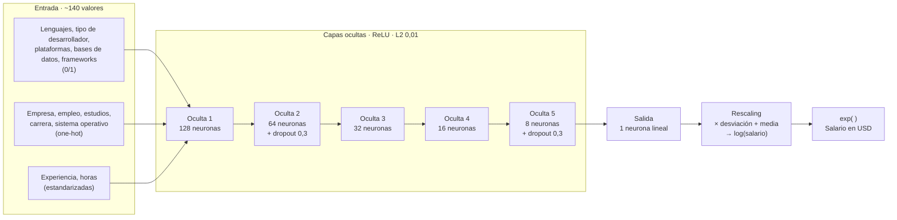

# Propuesta de proyecto: ¿qué explica el salario de un programador dentro de su país?

Cinco redes neuronales de regresión, una por país, sobre la encuesta Stack Overflow 2020,
entrenadas con el dataset que produce `limpieza_stackoverflow.py`.

---

## 1. Idea general

La primera versión entrenaba **una sola red para todos los países**, con el lenguaje, la
experiencia y el país como entradas. Siguiendo la recomendación del docente se cambió el
enfoque, por dos razones:

- **Comparar todos los países a la vez es poco práctico.** El país por sí solo explica
  casi toda la diferencia de salario (un programador de Estados Unidos gana muchas veces
  lo que uno de India) y tapa todo lo demás. El modelo terminaba aprendiendo sobre todo
  "en qué país vive", que es la parte menos interesante.
- **La pregunta útil es otra:** dentro de un mismo país, ¿por qué un programador gana más
  que otro? Y después, ¿pesan las mismas cosas en todos los países?

Por eso se entrena **una red por país**, cada una explica las diferencias de salario
**entre programadores de ese país**, y al final se comparan los resultados de las cinco
redes.

## 2. Tipo de problema

Es un problema de **regresión supervisada**:

- **Entrada:** el perfil del programador (12 variables, sección 4).
- **Salida:** un número continuo, el `log` del salario anual en USD.
- **Métrica principal:** el **R²**, la proporción de la variación del salario *dentro del
  país* que explica la red. Accuracy y F1-Score no aplican: son métricas de clasificación.

Por indicación del docente, las redes tienen **más de una capa oculta**.

## 3. Los 5 países

Se eligen con una regla, no a mano: **los 5 países con más salarios válidos** después de
la limpieza (sección 5). Una red necesita muchos ejemplos para aprender, y un país con
pocos datos daría un resultado que depende más de la suerte que del modelo.

| País | Salario reportado | Atípicos quitados | Salarios válidos |
|---|---|---|---|
| Estados Unidos | 8.123 | 679 (8,4 %) | **7.444** |
| India | 2.624 | 109 (4,2 %) | **2.515** |
| Reino Unido | 2.580 | 277 (10,7 %) | **2.303** |
| Alemania | 2.311 | 259 (11,2 %) | **2.052** |
| Canadá | 1.342 | 104 (7,7 %) | **1.238** |
| *Brasil (sexto)* | *1.155* | *22 (1,9 %)* | *1.133* |

Se consideró incluir Colombia, pero solo tiene **171 salarios reportados**: la red se
entrenaba con unas 115 personas y se evaluaba con 33, y el R² cambiaba mucho según qué
personas caían en cada conjunto. Con la regla de los 5 países más grandes, el más pequeño
(Canadá) tiene más de 1.200 personas.

## 4. Variables

### Cómo se eligieron

La versión anterior usaba solo lenguaje, experiencia y país. Sin el país, el lenguaje y la
experiencia explican apenas entre el 21 % y el 28 % del salario dentro de cada país. Se
probaron otras 15 preguntas de la encuesta con un criterio medible: para cada país, cuánto
**sube el R²** (validación cruzada de 5 pliegues, regresión lineal Ridge) al agregar cada
variable a ese modelo base. Se queda con las que lo suben **al menos 0,005 en promedio**.

| Variable | De dónde sale | Subida media del R² |
|---|---|---|
| Lenguajes | Columnas binarias `usa_*` (ya existían) | base |
| Experiencia profesional | `YearsCodePro` | base |
| Tipo de desarrollador | `DevType` → 24 columnas 0/1 | +0,034 |
| Tamaño de la empresa | `OrgSize` | +0,034 |
| Plataformas | `PlatformWorkedWith` → 17 columnas 0/1 | +0,033 |
| Sistema operativo | `OpSys` | +0,026 |
| Bases de datos | `DatabaseWorkedWith` → 15 columnas 0/1 | +0,020 |
| Nivel de estudios | `EdLevel` | +0,019 |
| Tipo de empleo | `Employment` | +0,018 |
| Horas de trabajo por semana | `WorkWeekHrs` | +0,011 |
| Frameworks web | `WebframeWorkedWith` → 17 columnas 0/1 | +0,010 |
| Carrera universitaria | `UndergradMajor` | +0,005 |

**Descartadas** porque no aportan: edad (+0,002), años programando en total (+0,003, repite
lo que ya dice la experiencia profesional), satisfacción laboral, género y etnia. Que estas
tres últimas no aporten tiene además una ventaja práctica: la calculadora no pregunta
datos personales sensibles.

### Codificación

- Preguntas de respuesta múltiple (lenguajes, tipo de desarrollador, plataformas, bases de
  datos, frameworks) → una columna 0/1 por opción.
- Categóricas (tamaño de empresa, empleo, estudios, carrera, sistema operativo) →
  *one-hot*; las categorías con menos de 5 personas se juntan en una sola columna.
- Numéricas (experiencia, horas) → estandarizadas (media 0, desviación 1).

Cada red queda con **136 a 142 entradas**.

## 5. Limpieza del salario

1. **Solo salarios reportados.** El 45,5 % de las filas del dataset limpio tiene el salario
   imputado con la mediana. Si entran al entrenamiento, la red aprende a contestar ese
   mismo número. La columna `ConvertedComp_reportado`, que se agregó a la limpieza antes
   de imputar, dice cuáles son reales.
2. **Sin salarios de 0 USD**: la red aprende `log(salario)` y `log(0)` no existe.
3. **Sin salarios imposibles (regla de Tukey).** En Estados Unidos **260 personas**
   reportaron exactamente 2.000.000 USD, que es el tope de la encuesta, y más del 5 % supera
   los 890.000 USD; en el otro extremo hay salarios de 100 USD al año. Son, casi seguro,
   salarios mensuales escritos como anuales o monedas equivocadas. Se descarta lo que queda
   fuera de `[Q1 − 1,5·IQR , Q3 + 1,5·IQR]` de `log(salario)`, **calculado dentro de cada
   país**, porque lo que es atípico en India es normal en Estados Unidos.

Quitar esos salarios fue el cambio que más subió el R² en Estados Unidos: pasó de 0,07 a
0,24 con solo lenguaje y experiencia.

## 6. División de datos

Cada país se parte por separado, con semilla fija:

| Conjunto | % del país | Para qué se usa |
|---|---|---|
| Entrenamiento | 70 % | Ajustar los pesos de la red. |
| Validación | 10 % | Vigilar el sobreajuste y activar el *early stopping*. |
| Prueba | 20 % | Medir el resultado final una sola vez, con datos que la red nunca vio. |

La elección de variables y de arquitectura usa solo el 80 % de entrenamiento + validación,
con validación cruzada de 5 pliegues. El 20 % de prueba no se toca hasta la evaluación
final.

---

# Arquitectura

| Parámetro | Valor | Motivo |
|---|---|---|
| Capas ocultas | 5 (128, 64, 32, 16, 8), ReLU | Cada capa combina los patrones de la anterior; las capas se van angostando hasta la salida. |
| Regularización | *Dropout* 0,3 después de la 2.ª y la 5.ª capa + L2 0,01 en todas | Con ~140 entradas y pocos miles de personas, sin regularización fuerte la red memoriza el entrenamiento. |
| Salida | 1 neurona lineal + `Rescaling` | La red aprende el salario estandarizado y la capa `Rescaling` lo devuelve a `log(salario)`. Sin estandarizar, la red arranca prediciendo 0 cuando la respuesta ronda 11 y el entrenamiento se vuelve inestable. |
| Pérdida | MSE sobre `log(salario)` | Penaliza errores relativos: equivocarse por 10.000 USD pesa más en un salario de 20.000 que en uno de 200.000. |
| Optimizador | Adam (tasa 0,001) | Buen comportamiento por defecto. |
| *Early stopping* | Paciencia 20 épocas, se queda con los mejores pesos | Corta cuando la validación deja de mejorar. |
| Lote / épocas | 32 / hasta 300 | |

### Selección de la arquitectura

Se usa **la misma arquitectura en los 5 países**, para que la comparación sea justa:
cambian los datos, no el modelo. La red de 5 capas se fijó de antemano; las demás se
entrenan solo como referencia. R² medio de validación cruzada de 5 pliegues:

| Arquitectura | EE. UU. | India | R. Unido | Alemania | Canadá | Media |
|---|---|---|---|---|---|---|
| **5 capas (128, 64, 32, 16, 8), dropout en 2.ª y 5.ª** — usada | 0,395 | 0,359 | 0,385 | 0,316 | 0,288 | **0,349** |
| 5 capas (64, 32, 32, 16, 16), dropout en 2.ª y 5.ª | 0,408 | 0,372 | 0,388 | 0,173 | 0,367 | 0,342 |
| 2 capas (64, 32) | 0,431 | 0,381 | 0,366 | 0,330 | 0,350 | 0,371 |
| 3 capas (64, 32, 16) | 0,420 | 0,376 | 0,348 | 0,349 | 0,335 | 0,366 |
| 3 capas (64, 32, 16), L2 fuerte | 0,414 | 0,382 | 0,399 | 0,407 | 0,383 | 0,397 |
| 3 capas (128, 64, 32) | 0,422 | 0,357 | 0,342 | 0,343 | 0,367 | 0,366 |
| Regresión lineal Ridge (referencia) | 0,388 | 0,378 | 0,325 | 0,418 | 0,369 | 0,376 |

**Más capas no dieron más R².** La red de 5 capas tiene unos 29.000 pesos para entre 870 y
5.200 personas por país, y solo dos capas con *dropout*: se sobreajusta más que la de 3
capas, sobre todo en los países con menos datos (Alemania y Canadá), donde además el R²
varía mucho entre pliegues. La versión angosta de 5 capas mejora en cuatro países pero en
Alemania deja de aprender (predice casi siempre el mismo salario), así que se descartó.

---

# Resultados

## Cada red (conjunto de prueba y validación cruzada)

| País | Personas (entren.) | R² validación cruzada | R² prueba | MAE red (USD) | MAE modelo base (USD) | Salario mediano (USD) |
|---|---|---|---|---|---|---|
| Estados Unidos | 5.210 | 0,395 ± 0,016 | 0,406 | 32.417 | 42.654 | 110.000 |
| India | 1.760 | 0,359 ± 0,054 | 0,439 | 7.282 | 10.195 | 10.052 |
| Reino Unido | 1.611 | 0,385 ± 0,058 | 0,302 | 25.570 | 31.247 | 64.630 |
| Alemania | 1.435 | 0,316 ± 0,160 | 0,399 | 13.350 | 17.636 | 62.697 |
| Canadá | 866 | 0,288 ± 0,151 | 0,394 | 14.720 | 19.524 | 65.799 |

El modelo base siempre predice la mediana del país (R² ≈ 0). Las cinco redes explican
**entre el 29 % y el 40 %** de la diferencia de salario dentro de su país (validación
cruzada) y se equivocan entre un 18 % y un 29 % menos que el modelo base.

**Frente al modelo anterior (R² 0,50):** ese número incluía las diferencias **entre**
países, que son las más fáciles de predecir. Las redes nuevas explican solo las
diferencias **dentro** del país, que son mucho más difíciles. La comparación justa es
contra lenguaje + experiencia dentro de cada país (0,21–0,28): las variables nuevas, la
limpieza de atípicos y la red profunda suben el R² dentro de cada país.

## Comparación entre países

| País | Variable más importante | Segunda | Salario con 10 años / con 1 año |
|---|---|---|---|
| Estados Unidos | Experiencia profesional | Tipo de desarrollador | × 1,36 |
| India | Experiencia profesional | Tamaño de la empresa | × 3,17 |
| Reino Unido | Experiencia profesional | Tipo de empleo | × 1,54 |
| Alemania | Experiencia profesional | Tamaño de la empresa | × 1,23 |
| Canadá | Experiencia profesional | Lenguajes | × 1,31 |

- La importancia se mide **por permutación**: se desordena una variable en el conjunto de
  prueba y se mide cuánto cae el R².
- El crecimiento con la experiencia sale de una **gráfica de dependencia parcial**: a todas
  las personas de prueba se les cambia solo los años de experiencia y se toma la mediana
  del salario predicho.

**Lectura:** la experiencia es lo que más pesa en los cinco países, pero no paga igual. En
India el salario se **triplica** entre 1 y 10 años de experiencia; en Alemania sube apenas
un 23 %. Después de la experiencia, en India y Alemania pesa más **dónde** se trabaja
(tamaño de la empresa) que **con qué** se trabaja; en Estados Unidos pesa el tipo de
desarrollador (con el tamaño de la empresa casi empatado), en el Reino Unido el tipo de
empleo y en Canadá, los lenguajes.

## Rango de la estimación

La calculadora muestra un rango del 68 % (`estimación × e^(∓σ)`), con una σ robusta
(`1,4826 × MAD`) calculada con los residuos fuera de pliegue de la validación cruzada.
En prueba, entre el 64 % y el 73 % de las personas cae dentro del rango, cerca del 68 %
esperado.

| País | σ | Rango del 68 % | En prueba dentro del rango |
|---|---|---|---|
| Estados Unidos | 0,304 | × 0,74 a × 1,36 | 66,4 % |
| India | 0,602 | × 0,55 a × 1,83 | 71,8 % |
| Reino Unido | 0,340 | × 0,71 a × 1,41 | 63,8 % |
| Alemania | 0,244 | × 0,78 a × 1,28 | 67,2 % |
| Canadá | 0,303 | × 0,74 a × 1,35 | 73,0 % |

---

# Entregables

| Archivo | Qué es |
|---|---|
| `red_neuronal_salarios.ipynb` | Las 9 fases: filtrar y elegir países, partir, elegir variables, elegir arquitectura, entrenar, evaluar, comparar países, residuos y guardar. |
| `calculadora_salarios.py` | App de Streamlit: se elige el país y el perfil, y la red de ese país estima el salario. Incluye el mismo perfil evaluado en los 5 países y el recorrido del dato por las capas de la red. |

## Riesgos conocidos

- **La encuesta no tiene todo:** faltan el cargo exacto, la ciudad y la empresa concreta.
  Un R² cercano a 0,40 dentro de un país es razonable y hay que presentarlo con honestidad.
- **La red de 5 capas queda por debajo de la regresión lineal** en validación cruzada
  (0,349 contra 0,376 en promedio), aunque en prueba la supera en 3 de 5 países. Con estos
  datos, más profundidad no aporta: la información de la encuesta pone el techo, no la
  arquitectura.
- **Inestable con pocos datos:** en Alemania y Canadá el R² varía ±0,15 entre pliegues.
- **Variación entre particiones:** en el Reino Unido el R² de prueba (0,30) queda lejos del
  de validación cruzada (0,39). Por eso la cifra de referencia es la de validación cruzada,
  que promedia cinco particiones.
- **Solo 5 países:** las conclusiones valen para mercados grandes y no se pueden extender a
  países con pocos datos en la encuesta, como Colombia.
